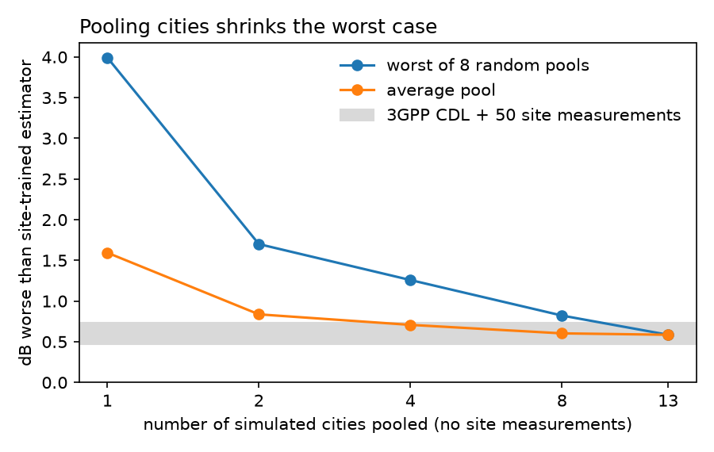
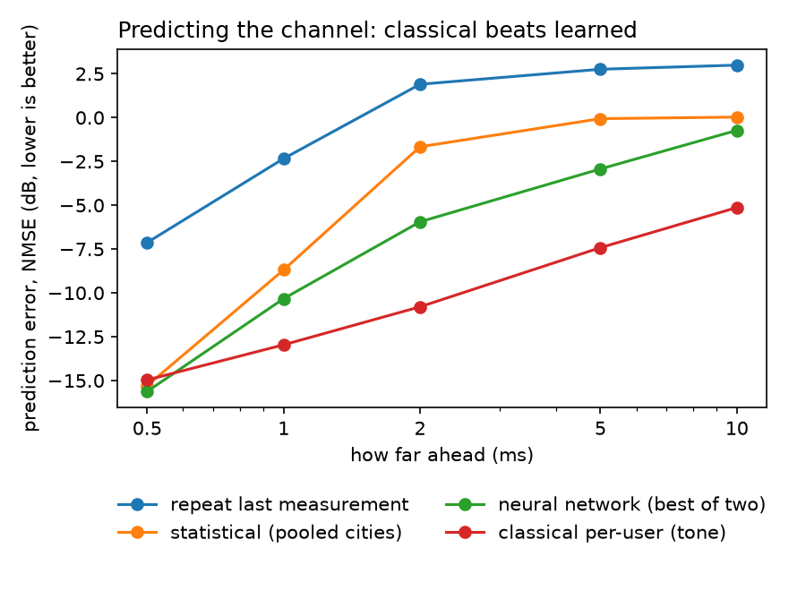

# Do simulated cities help a 5G base station at a site it has never seen?

A base station has to keep estimating the radio channel — how its signal
bounces, fades and shifts on the way to each phone — and estimators are usually
tuned on 3GPP's generic stochastic channel models, which don't resemble any
particular street. Ray tracers like NVIDIA Sionna RT can simulate real city
layouts instead. This project asks whether that helps at a **new** site, and
whether **learned** models are what make the difference.

Findings 1–3 come from simulation (14 ray-traced city scenes, an 8-antenna
base station at 3.5 GHz, 5G NR-like OFDM); finding 4 tests finding 1 on real
measured channels — and reverses it. The four main experiments (4-city,
14-city, prediction, measured channels) had their expected outcome and
pass/fail bar written down before they ran (for the measured-channel test, a
pilot had already scored the 3GPP baseline on the test data, and a dry run
had touched it); follow-up
checks are labelled post-hoc in the [lab notebook](docs/PLAN.md).

**In short:** in simulation, pooling many simulated cities looked like a good
starting point for a new site. On real measurements from one site it was worse
than 3GPP's generic models — the simulated channels were too clean; an
exploratory rerun with scattering switched on in the ray tracer roughly
matched them.
Learned models never beat the classical methods; at best they refined them.

## Findings

**1. In simulation, pooling many simulated cities is insurance.** With no measurements at a
new site, a linear (LMMSE) estimator built from channel statistics pooled over
many ray-traced cities comes within about 0.6 dB of one trained on that site —
roughly what the 3GPP CDL models reach only after 50 site measurements. Any
single city can be a bad match (up to ~7 dB worse); pooling more cities shrinks
the worst case much faster than the average.

Once 50 site measurements exist, the pooled prior and CDL end up comparable
(pooled ahead by ~0.1 dB on built-up sites). Picking the single best-matching
city from 50 measurements worked with 3 candidates but overfit with 15.

**2. A neural network added little.** A CNN refining the linear estimate gained
at most 0.65 dB. The statistics did the work.

**3. Predicting the channel ahead: a classical method beat the neural
networks.** Predicting 0.5–10 ms ahead from ~1.8 ms of noisy history, a simple
per-user method — fit one Doppler tone per angle-delay bin, extrapolate — beat
both CNN predictors at every horizon from 2 ms in all four cities, by 1.8–12
dB with no site data. The pre-registered test for "learning has room here" failed.

A follow-up check, added after these results and labelled as such: a CNN
trained to *correct* the classical method's prediction, rather than replace
it, adds a small but repeatable ~0.3–0.6 dB at 2–10 ms in three of four cities
(same result on two training seeds), and costs about 1 dB at 5–10 ms in San Francisco,
where the classical method is already near-exact. Retraining the original
CNNs with a loss focused on the predictable horizons did not close the gap.
So: classical first, learning as a refinement on top.

The obvious objection, stated up front: Sionna moves users by rotating the
phases of a fixed set of paths, which is exactly the tone model. A separate
check (re-tracing each user at its moved position) showed this matches the full
simulation up to ~10 ms for nearly all users at 3.5 GHz — but on real channels,
the classical method would degrade by an amount simulation can't measure.

**4. On real measured channels, the simulated cities lost.** A follow-up
test used the University of Stuttgart's DICHASUS measurements: three antenna
arrays on one building, a transmitter pulled along the street, 1.27 GHz. All
14 cities were re-simulated with the same array and a facade-like placement, and
every source went through one processing chain. With no site measurements,
the pooled simulated prior was 3–4 dB *worse* than the 3GPP CDL model on the
full array (0.5–1.3 dB worse per antenna), and on the full array no single
city beat CDL either; with 50 measurements, CDL still led by 1.2–1.7 dB on the
full array (per antenna the two tied). Pooling still shrank the worst case,
but around a worse level. The simulated channels were cleaner in delay than
the real street (89–100% of energy in the first 160 ns across the 14 cities,
79–84% measured), and the placement rule put simulated users farther away and
at a shallower angle than the real ones. Finding 1 held only on simulated ground — the
caveat stated before the first run.

An exploratory rerun suggests the ray tracer's settings, inherited from the
simulation study, drove most of the gap: with scattering off rough surfaces
and wedge diffraction switched on (7 cities, added after a dry run, labelled as
such), the simulated prior came within 0.3–0.5 dB of CDL on the full array
and level with it per antenna (slightly ahead on two arrays) — a match, not a
win. A second exploratory probe placed the simulated users at the real users'
distances and the gap reopened (2.9 dB behind CDL): closer simulated users are
even more line-of-sight dominated, while the real street has extra multipath
the map-built scenes lack. One site, one band, one scattering value.

**5. Where does CDL fall short? Not more in a factory than on a street.** A
pre-registered follow-on reran the measured-channel pipeline on two more
DICHASUS sites recorded with the same sounder. With no site data, the generic
CDL prior sat 2.5–2.7 dB from a site-trained estimator on the street, 2.1–2.8
dB in a factory hall and 4.7 dB in a small lab room, whose delay spread lies
below the prior's 30–300 ns range (a 30 ns profile fixes it per antenna). The
expectation that CDL falls further short in a dense factory was not supported.
Blending 50 site measurements into the prior closed most of the per-antenna
gap on most arrays, but not on two of the four factory arrays (cause not
established). A first analysis reported a 10–12 dB factory gap; a review
found the factory recording's timing offset had defeated the processing chain,
which was fixed and the factory rerun (street and lab unchanged).

A paper-style write-up is in [docs/paper/paper.pdf](docs/paper/paper.pdf), a plain-language
version in [docs/PLAIN.md](docs/PLAIN.md), and a 90-second video summary in
[docs/video/6g-study.mp4](docs/video/6g-study.mp4).

## How it was done

- **Scenes:** Sionna RT's four built-in cities plus ten New York areas built
  from OpenStreetMap with [geo2sigmap](https://github.com/functions-lab/geo2sigmap),
  reading buildings from an offline [Geofabrik](https://download.geofabrik.de)
  extract (the public Overpass API is for interactive use only).
- **Test design:** leave-one-city-out — each city in turn is the unseen site,
  with test users at base-station positions the priors never saw. Results were
  rechecked on freshly drawn sites, training sets and site samples.
- **Estimators:** LMMSE from covariance priors (3GPP CDL, single cities,
  pooled cities), blended with site data by cross-validated shrinkage; a
  residual CNN on top; for prediction, the same plus the per-user tone method
  and CNNs in both the antenna and angle-delay domains.
- **Compute:** one laptop (Apple M4, Sionna on Metal). No cloud.

## Limits

- Findings 1–3 are simulation-to-simulation: test channels come from the same
  ray tracer as the priors. The one measured-data test (finding 4) is a single
  site at 1.27 GHz, mostly line-of-sight, and it reversed finding 1.
- One linear estimator family. Findings 1–3: one array (8-antenna ULA), one
  band (3.5 GHz); 10 of 14 cities from one US state.
- Most randomly placed users receive no ray-traced paths and are dropped, so
  the remaining users skew toward simpler, line-of-sight-like links.
- The estimation CNNs used one random seed. The original prediction CNNs were
  trained on the whole track; the follow-up reweighted that loss (it did not
  help) and ran the tone-correcting CNN on two seeds.
- Sionna RT's path solver is non-deterministic by default; the prediction
  re-trace check was rerun with `deterministic=True` and its conclusion held.

## Related work

Closest found: site-specific ray-traced or digital-twin priors for a channel
covariance, subspace or channel statistics
([2607.09334](https://arxiv.org/abs/2607.09334),
[2501.02758](https://arxiv.org/abs/2501.02758),
[2411.13360](https://arxiv.org/abs/2411.13360)); pre-training across source
cities and adapting to a target site, for CSI feedback
([2605.16141](https://arxiv.org/abs/2605.16141));
stochastic vs ray-traced data for ML, including prediction
([2512.12449](https://arxiv.org/abs/2512.12449)); learned prediction beating a
classical Prony angle-delay baseline on 3GPP-compliant QuaDRiGa channels
([2412.08908](https://arxiv.org/abs/2412.08908)); neural network predictors
compared on the 3GPP tapped-delay-line model
([2308.14020](https://arxiv.org/abs/2308.14020)). A search did not find the
pooled-city worst-case result or a classical predictor beating learned ones on
ray-traced channels; that is a search, not a full review.

## Reproduce

Python ≥ 3.12 with [uv](https://docs.astral.sh/uv/): `uv sync`. Every script
takes the base-station antenna count (`8`). Channel sets are generated on first
use and cached under `data/` (~34 GB for everything); raw logs and result
tables are in `runs/`.

| result | command |
|---|---|
| 4-city leave-one-out | `scripts/make_data.py 8`, `scripts/loco.py 8 0`, `scripts/report.py runs/a8_sc128/loco_seed0.csv` |
| fresh-site recheck | `scripts/fresh_sites.py 8` |
| New York scenes | `scripts/build_library.sh <new-york-latest.osm.pbf>` (needs `osmium-tool`, `libusb`), then `scripts/make_library.py 8` |
| 14-city library | `scripts/library.py 8`, `scripts/library_followup.py 8`, `scripts/pool_draws.py 8` |
| prediction | `scripts/make_tracks.py 8`, `scripts/predict.py 8 0`, `scripts/predict_fair.py 8 0` |
| measured channels (DICHASUS) | download `dxxx-complete` from [DaRUS](https://doi.org/10.18419/DARUS-3153) into `data/dichasus/raw/`, convert with `scripts/dichasus_convert.py` (needs TensorFlow), then `scripts/dichasus_test.py`; exploratory `scripts/dichasus_rich.py`, `scripts/dichasus_diagnostics.py` |
| figures | `scripts/figures.py` |

A results summary with every number is in [docs/RESULT.md](docs/RESULT.md).

Built with [Sionna](https://github.com/NVlabs/sionna). Map data © OpenStreetMap
contributors. Measured channels: DICHASUS (University of Stuttgart), CC BY 4.0.
